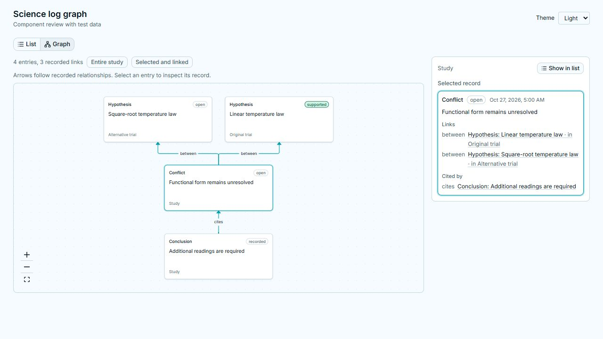

# Science log relationship graph

The Science log offers List and Graph views over the same study. The graph shows
the recorded entry relationships, including hypotheses, observations, evidence,
conflicts and conclusion citations. Selecting a node opens its original entry
in an inspector beside the graph, or below it in a narrower pane. Show in list
returns to the same entry in its branch's chronological log. The existing branch
hierarchy, task/folder navigation and record source controls remain available in
List. Inspect selects a record before switching to Graph.

Entire study shows all entries. Selected and linked shows the selected entry
and its direct incoming and outgoing relationships. Zoom and fit controls let
readers inspect larger studies. The graph refits when its pane resizes, without
resetting manual zoom on ordinary selection changes. Missing targets remain visible as
unavailable entries. Relationship arrows retain the recorded direction. Cycles
are preserved, so the view does not assert that scientific reasoning is always
a DAG. Branch names remain attached to entries.

No server schema or scientific status is changed. The graph reuses the existing
entry-summary, status, citation and derivation readers, React Flow, Dagre and
the existing science status component. The inspector uses the existing record
renderer, including observation sources, linked evidence, files and transcript
navigation. It does not introduce a second record format.

## Component review

These captures show the production component with explicitly labelled test data.
They are UI review evidence, not scientific results from a fresh agent run.

Dark appearance: [graph](screenshots/science-log-list-graph-dark.jpg).
Chronological records: [list](screenshots/science-log-list-view-light.jpg).

## Validation

- Focused Vitest run: 17 passed across `study-graph.test.tsx` and the existing
  `science-log-tab.test.tsx`, with no skipped tests.
- Workspace `pnpm typecheck`: passed. The final web typecheck also passed after
  the resize behavior was added.
- Package linters (`pnpm -r --workspace-concurrency=1 lint`): passed. Changed
  components also pass Oxlint with `--deny-warnings` and Prettier.
- Production and offline-review builds (`pnpm build`): passed.
- `git diff --check`: passed.
- Browser review: List/Graph selection, cross-branch inspector citations,
  Show in list, graph scope, light/dark appearance, and responsive placement
  worked. After resizing an 820 px pane back to the default width, all graph
  nodes were within the canvas bounds. The fresh page had no console errors.

The browser review used the explicitly labelled fixture under `web/tests/`.
It verifies rendering and interaction, not scientific acceptance on a fresh
agent investigation. Its screenshots were not added to the PI presentation.
The broad workspace test run passed all 325 core tests, then encountered an
unrelated workspace-polling assertion and was stopped. The failure reproduces in
an isolated run of `use-workspace-data.test.tsx`: “does not re-render the workspace
when a poll returns the same data” observes 5 renders instead of 4. Its hook and
test are unchanged from the Claude base. That isolated run reports 36 passed and
1 failed across the polling and science-log files. The feature-only rerun passes
all 17 tests.

Root `pnpm lint` also fails before package linting: `check_theme_colors.mjs` uses
a literal `/` in its directory exclusion, so on Windows it scans the excluded
theme definitions. The checker and theme files are unchanged from the base.
Neither failure is reported as a passing gate.

The temporary review tab was closed and the owned Vite preview and its verified
descendants were force-stopped after review; graceful settlement is not claimed.
The checkout and installed dependencies remain available on
`codex/science-log-graph`, based on `claude/delegation-fork-science` at
`4ac493f556046be6a1d438ad34e89b44a415cf95`.
