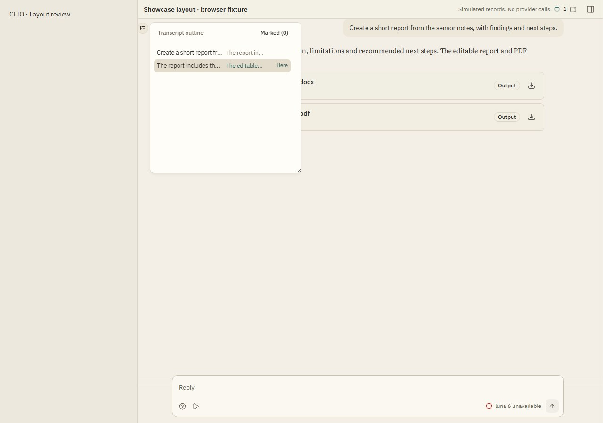
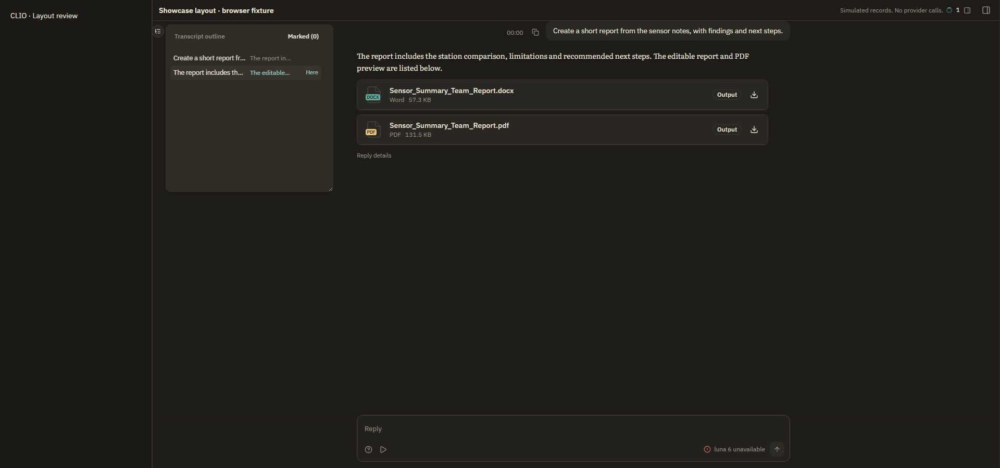
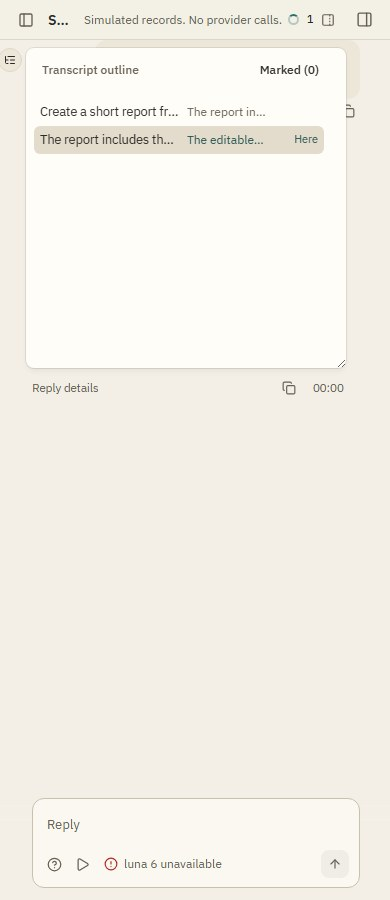

# Transcript outline

The transcript outline is the conversation's one index. The **Open transcript
outline** control at the left of the session header opens a list of the
conversation's turns. Hovering a row previews it, and choosing a row scrolls the
transcript there. The same control works at every width, including phones. The
earlier coloured landmark strip in the left margin was removed under the
visual-language spec (see `web/src/components/clio/transcript-outline.tsx`), so
the captures below show the outline instead.

## Release refresh (2026-11-11)

Recaptured from the develop build at `96dbbd2e1` with the labelled
`session-showcase` component fixture. Its records are simulated, not fresh provider
inference. File names are unchanged so existing links keep working.

- `desktop-landmarks.jpg`: 1280 × 900, light, outline open.
- `wide-hover.png`: 1920 × 900, dark, outline open with a row hovered.
- `phone-outline.jpg`: 390 × 900, light, outline open.

## Earlier landmark review (history)

The colored transcript landmarks were slightly thicker at rest (3 px) and expanded
to 5 px under the pointer or at the active message. Their length grew only into
the spare left margin, up to 56 px. Phones kept the compact outline. Those
landmark captures were browser fixtures: the light ones from the labelled
`session-showcase` fixture, the dark hover from the stateful workspace E2E fixture.

The individual unit case retains landmark accessibility, distinct transcript
prose, previews and navigation. The focused production-route margin case checks
1280/1920 px layouts, the Wide preference at 1280 px, the compact outline at
390 px, and unchanged transcript geometry on hover. The existing dense workspace
case checks navigation, isolated wheel scrolling, keyboard access, adjacent
landmarks, previews, canvas behavior and accessibility. It passes on Windows and
Linux with one worker, using the same browser build.

The Windows and Linux desktop and mobile workspace snapshots were reviewed and
regenerated for the intentional accumulated composer/activity/toolbar changes
and new marker sizing. Both desktop and mobile cases passed again against the
accepted references on each platform. The existing pixel tolerances are unchanged.
A separate CI query repair
scopes the visible `Settled` badge to the evidence button, preserving the
independent screen-reader status assertion.

Original captures, focused check/build logs, Linux reproduction script and
SHA-256 manifest are archived in
`D:/Libraries/Videos/clio_recordings/2026-10-07-transcript-minimap`.
